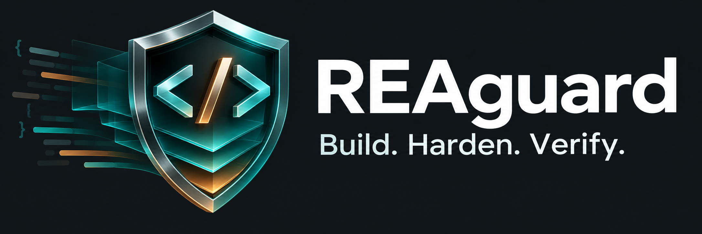

# REAguard



**Software hardening with an attributed Rust engine and a cautious JavaScript workflow.**

[](https://github.com/firstninja-v/-reaguard/actions/workflows/test.yml)
[](https://github.com/firstninja-v/-reaguard/actions/workflows/engine.yml)
[](LICENSE)

REAguard combines the complete MIT-licensed [die-a-rea](https://github.com/danihelenterprises/die-a-rea) toolkit with our parser-based JavaScript packaging, browser compatibility fixtures, upstream provenance checks, and targeted safety fixes. **Version 0.3.0 is experimental.** No software is uncopyable, and no transform is guaranteed to preserve every application.

## Choose your workflow

| Workflow | Use it for | Requirements |
| --- | --- | --- |
| `reaguard engine …` | Original multi-format toolkit: native files, JS/Electron, WASM, JVM/Android, manifests, adapters, RRS reports | Node.js 22+, current stable Rust; optional toolchains for adapters |
| `reaguard plan/build/verify …` | Conservative packaging of one self-contained JavaScript bundle | Node.js 22+ |

The original engine's commands and formats remain available; the two workflows have **different options, defaults and verification semantics**. Engine RRS is a heuristic exposure report, not a measured probability of stopping AI cloning. JS verification compares unsigned hashes; it does not certify behavior.

## Install and try the full engine

```sh
git clone https://github.com/firstninja-v/-reaguard.git reaguard
cd reaguard
npm ci --ignore-scripts
npm run engine:build
npm link
reaguard engine doctor
```

Install Rust from [rustup.rs](https://rustup.rs/) if Cargo is missing. The engine is built from source; no automatic binary download occurs. On Windows, Rust may require Visual Studio C++ build tools. `npm link` creates the command locally; without it, run `node /absolute/path/to/reaguard/src/cli.js engine …`.

From the directory containing the software you own or are authorized to protect:

```sh
reaguard engine init --name my-app dist/app.js
# Review die-a-rea.toml before building; start with profile="low".
reaguard engine plan
reaguard engine build --out dist-hardened
reaguard engine verify --original dist/app.js --hardened dist-hardened/dist/app.js --json
```

The default manifest is intentionally still named `die-a-rea.toml`. Review the generated configuration: use low intensity first, disable randomization/tarpits unless needed, and enable application-specific verification. Higher profiles, adapters and runtime guards may alter behavior, size, startup time or antivirus reputation. Signing-sensitive artifacts must be re-signed after modification.

See [engine setup, profiles and adapters](docs/ENGINE.md) for a concrete cautious configuration. Full upstream documentation is retained in [engine/README.md](engine/README.md), including all advanced features and limitations.

## Quick JavaScript-only demo

No Rust installation is needed for this workflow:

```sh
npm test
node src/cli.js plan examples/calculator.cjs
node src/cli.js build examples/calculator.cjs --out release-demo
node src/cli.js verify release-demo
```

This lane defaults to no identifier renaming, compression or decoys. It writes a new directory and preserves the source. It detects common dependency/path hazards, checks final syntax, records module type, and supports a user-provided application check. [JavaScript guide and CLI reference](docs/JAVASCRIPT.md).

## What REAguard adds

- A single branded entry point without silently renaming upstream protocols or manifests.
- Fixes for line-based JS cleanup that deleted real marker-containing code or template data; ambiguous input is preserved rather than guessed at.
- A CommonJS boundary so imported Node adapters keep working inside our ES-module repository.
- A separate parser-based JavaScript lane with cautious defaults and optional shell-free application validation.
- Regression, native smoke and browser pixel/interaction tests; reproducible upstream file/patch inventories.

These are specific engineering improvements, **not proof of stronger anti-cloning effectiveness**. We do not modify RRS weights to produce a more flattering score.

## Will my app still work?

Always test the produced artifacts with your own application's test suite and deployment pipeline. Our browser fixtures exercise clicks, forms, styling, screenshots and state; they cannot certify every framework or product. Keep the original release for rollback.

Neither workflow automatically updates HTML/CSS, chunk references, CSP/SRI hashes, service-worker manifests or code signatures. The JS lane does not copy dependencies/assets. Advanced engine options retain upstream behavior, including an explicit force-overwrite option; choose a fresh output directory and avoid `--force` during normal use.

## Test and contribute

```sh
npm test
npm run upstream:check
npm run engine:test
npx playwright install chromium firefox webkit
npm run test:browser
```

The Engine workflow builds/tests Rust, checks formatting/lints and runs the engine bridge smoke tests. Linux also runs documentation invariants, benchmark gates and a real compiled native sample. External obfuscators, every platform-specific signing flow and arbitrary real products require additional validation.

[Validation scope](docs/VALIDATION.md) · [Architecture](docs/ARCHITECTURE.md) · [Roadmap](ROADMAP.md) · [Contributing](CONTRIBUTING.md) · [Security](SECURITY.md)

## Attribution and license

MIT. The imported engine is copyright © 2026 die-a-rea contributors; its [original license](engine/LICENSE) is retained. REAguard additions use the [root license](LICENSE). [THIRD_PARTY_NOTICES.md](THIRD_PARTY_NOTICES.md), [UPSTREAM.json](UPSTREAM.json) and [UPSTREAM_PATCHES.json](UPSTREAM_PATCHES.json) document the source and changes. This is an attributed integration, not a claim that we independently invented the upstream engine.

If REAguard helps your workflow, star the repository or contribute a compatibility fixture and reproducible benchmark.
